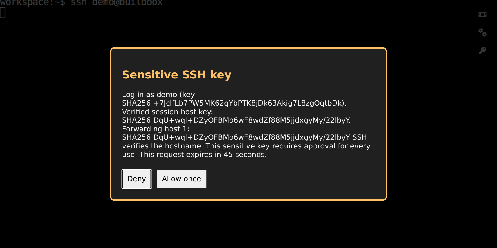

# WeTTY = Web + TTY.

**WeTTY Knock** — *Sensitive SSH keys knock before use.*

WeTTY Knock adds browser-managed SSH keys and per-use approval for sensitive keys.

**Upstream project:** [WeTTY](https://github.com/butlerx/wetty), originally created by
[Krishna Srinivas](https://github.com/krishnasrinivas) and maintained by [Cian Butler](https://github.com/butlerx).

## Prerequisites

- node `^22.23.4 || ^24.22.1 || >=26.12.1` — only the Node lines that carry the fix for the Brotli decoder RCE
  (CVE-2026-111497); 18, 20, 23 and 25 are EOL and never get it
- make
- python
- build-essential

## Usage

Open WeTTY Knock in your browser and click the key icon to manage your SSH keys. See the
[browser key login guide](docs/browser-key-login.md) for enrollment and per-use approval.

For the Docker setup used by this fork, see the [deployment notes](containers/local-deployment/README.md).

## FAQ

Check out the [docs](docs/)

- [Running as daemon](docs/service.md)
- [HTTPS Support](docs/https.md)
  - [Using NGINX](docs/nginx.md)
  - [Using Apache](docs/apache.md)
- [Automatic Login](docs/auto-login.md)
- [Downloading Files](docs/downloading-files.md)

### What browsers are supported?

WeTTY supports all browsers that [xterm.js supports](https://github.com/xtermjs/xterm.js#browser-support).

## Contributing

See the [development guide](docs/development.md) to build and test WeTTY Knock locally.

## Show your support

Give a ⭐️ if this project helped you!

## 📝 License

Copyright © 2019 [Cian Butler <butlerx@notthe.cloud>](https://github.com/butlerx).  This project is
[MIT](LICENSE) licensed.

---
